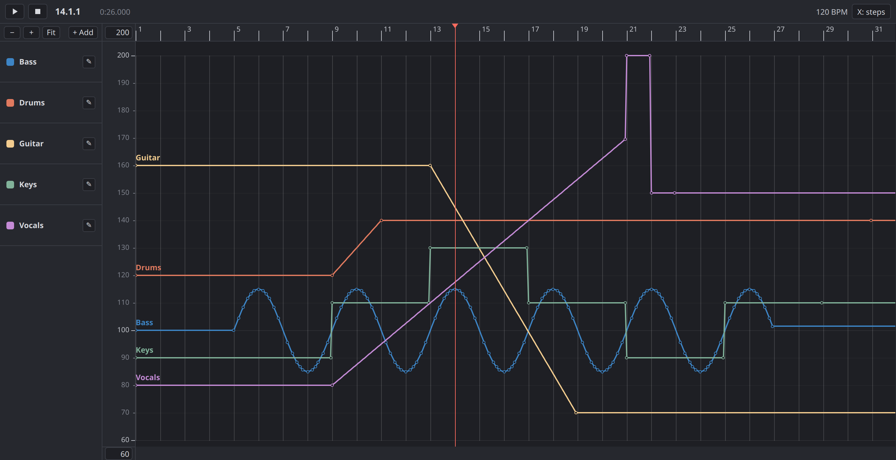
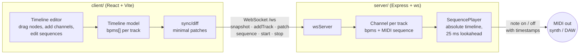
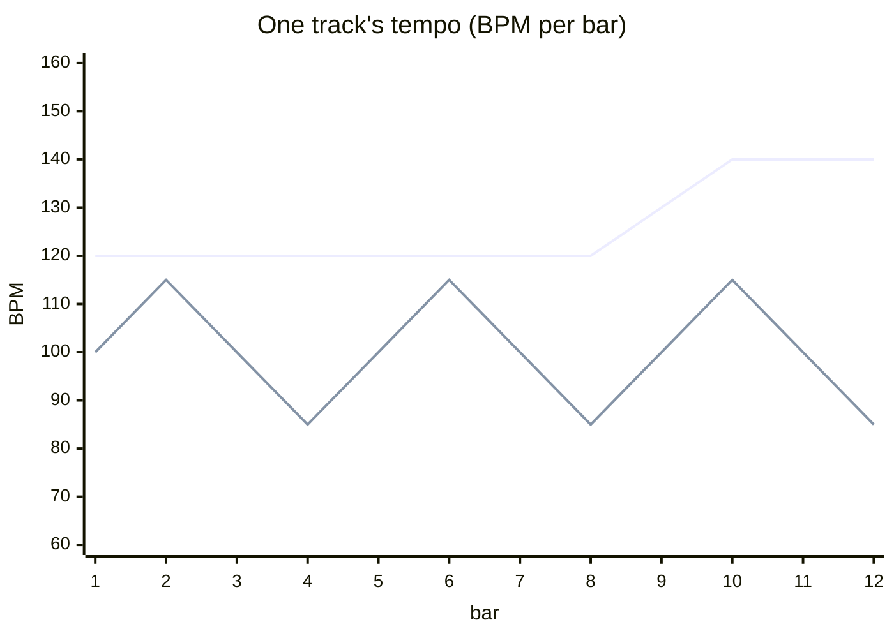
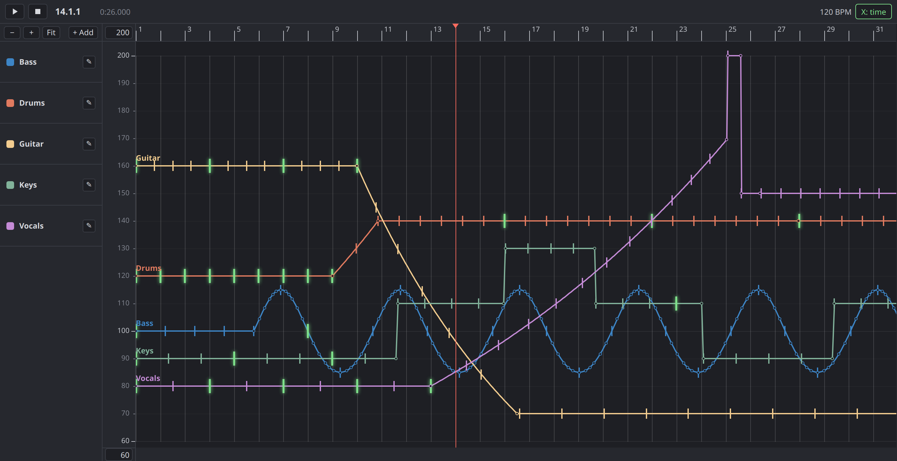
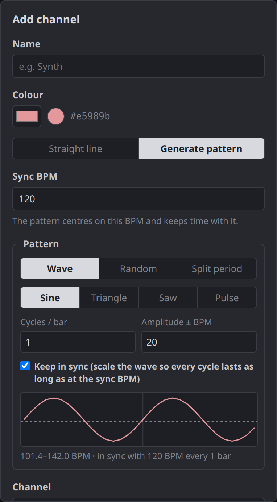
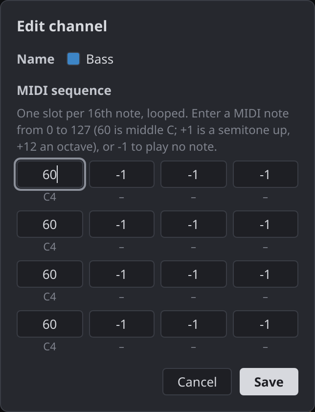

# TempoAsync

A MIDI sequencer where **every channel has its own tempo curve**. Instead of one global BPM, each
track is a line of BPM values over time: draw ramps, waves or terraces, and each channel's MIDI
loop speeds up and slows down along its line. The tracks drift apart and land back together, and the
**sync view** shows exactly when.



## How it works

The browser is the editor; the Node server plays the MIDI. The client owns the state, sends a snapshot
when it connects and then streams only the edits over a WebSocket. The server keeps one channel per
track and schedules its notes ahead of time with MIDI timestamps.



## Features

### Tracks are tempo curves

Each track stores one BPM per 16th-note step. Every step lasts `60 / bpm / 4` seconds at its own BPM,
so the same 16-step loop plays faster where the line is high and slower where it is low.



Drag a node to reshape the line; points between two nodes follow the straight line between them.
Edits during playback reach the server as small patches and apply from the next step it schedules.

### Sync view

**X: steps** draws step *i* of every track at the same x. **X: time** draws each step at the real time
it sounds, with a tick on every beat of the line. Downbeats that land on a bar line of the project
tempo light up green, so you can see where the tracks line up again.

```mermaid
gantt
    title Beats in the first 2 seconds at three tempos (ms)
    dateFormat x
    axisFormat %L
    section 120 BPM (project)
    beat 1 :0, 500
    beat 2 :500, 1000
    beat 3 :1000, 1500
    beat 4 :1500, 2000
    section 160 BPM
    beat 1 :0, 375
    beat 2 :375, 750
    beat 3 :750, 1125
    beat 4 :1125, 1500
    section 80 BPM
    beat 1 :0, 750
    beat 2 :750, 1500
```





### Generated patterns that stay in sync

**+ Add** opens a dialog with a straight line or a generated pattern: a **wave** (sine, triangle,
saw, pulse), **random** values, or a **split period** (part of each period at one BPM, the rest at
whatever keeps time). With *keep in sync* on, every window lasts exactly as long as at the sync BPM,
because the window's harmonic-mean BPM equals the sync BPM. The line wanders, but the downbeats come
back on the grid.

<p>
  
  
</p>

### MIDI sequence per channel

Each track has a MIDI channel (1–16) and a looping sequence of up to 16 steps: a note from 0–127, or
`-1` for a rest. Edit it from the ✎ button next to the track name.

### Timeline editing

- Ctrl/Cmd + wheel or pinch to zoom time; Alt + wheel to stretch the BPM axis; **Fit** shows everything
- Edit the BPM range with the inputs at the top and bottom of the axis
- Space plays and pauses; click or drag the ruler to move the playhead

## Getting started

You need Node.js and a MIDI output: a hardware synth, a DAW, or a virtual MIDI port.

```sh
# backend: Express + WebSocket + MIDI, http://localhost:3000
cd server && npm install && npm start

# frontend: Vite dev server, http://localhost:5173 (proxies /ws to the backend)
cd client && npm install && npm run dev
```

Tests: `npm test` in `client/` (Vitest) and in `server/` (node:test).
[`client/README.md`](client/README.md) covers the timeline architecture in depth.
